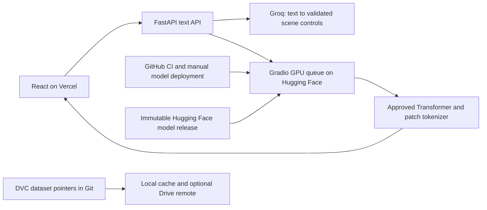

# Text-to-image platform



The existing Gradio interface remains at the Space root. The same Space can
host `/api/health`, `/api/v1/model`, `/api/v1/interpret`, and `/api/v1/generations` alongside it.
The API enqueues GPU work through the Gradio client, retaining ZeroGPU's queue.
You can alternatively deploy `backend/Dockerfile` to a separate CPU host.
No training runs in the backend or CI.

## Start locally

Create a virtual environment, install `backend/requirements.txt`, and copy
`.env.example` to `.env`. Set `GROQ_API_KEY` locally; never put it in React or Git.
Then run from the repository root:

```powershell
python -m uvicorn backend.app:app --host 127.0.0.1 --port 8000
```

In another terminal:

```powershell
cd frontend
npm.cmd ci
npm.cmd run dev
```

Open http://localhost:5173. The Vite development proxy forwards `/api` to the
local backend. Text uses Groq's JSON-object mode plus strict server-side
validation. Unsupported concepts are shown to the user before any GPU request.
JSON validity does not guarantee perfect interpretation; inspect the displayed
scene controls. No executable code from the LLM is run.

## Deploy frontend and configure hosted backend

1. In Hugging Face Space Settings → Variables and secrets, add **secret**
   `GROQ_API_KEY`. `GROQ_MODEL` defaults to `qwen/qwen3.8-27b` and is configurable.
2. Import the GitHub repo into Vercel. Select **frontend** as the root directory,
   Vite as framework, `npm run build` as build command, and `dist` as output.
3. Set Vercel environment variable `VITE_API_BASE_URL` to
   `https://adamnouassida5-deeplearning.hf.space/api` and deploy.
4. Add your exact Vercel production origin to the Space's `CORS_ORIGINS`
   variable (comma-separated; include `http://localhost:5173` for local testing).
5. Verify `/health`, interpret a landscape, then generate one image.

Both hosting platforms use HTTPS. The backend ships a CPU Dockerfile for other
hosts; build from the repository root with `docker build -f backend/Dockerfile .`.
Do not put Groq or Hugging Face tokens in `VITE_` variables.

The API limits POST requests to eight per client per minute and 32 globally per
minute in one process, and admits one generation at a time. Run one worker.
These demo limits are not distributed abuse protection; add authentication and
a shared limiter before serving substantial public traffic. Request logs contain
IDs, status and duration, not prompts or keys. Native PNGs are returned as base64.

ZeroGPU quota is unchanged by the text bridge. A backend HF token spends that
account's quota; anonymous calls have stricter shared limits. Exhaustion is a
structured 429 response, not a model failure. The Groq key is a separate quota.

## Model versions

`models/registry.json` identifies model version, parameters, epoch, checkpoint,
tokenizer and dataset hashes, and the immutable Hub commit. The approved active
release is `landscape-large-v1`. Smaller and cleaner-data candidates remain separate.

```powershell
python -m mlops.release --version new-version --checkpoint checkpoints/my_model/best.pt
python -m mlops.release --version new-version --publish-repo adamnouassida5/pixel-landscape-transformer
```

Exported files live under ignored `artifacts/releases/`. Publishing creates a
tag and pinned commit, and refuses to overwrite an existing remote version.
It does not promote or deploy the model. After evaluation, set its registry
status to `approved` and update `active_version` in a reviewed code change.
Deploy that exact release with the manually triggered GitHub workflow or:

```powershell
python mlops/deploy.py --version landscape-large-v1
python mlops/healthcheck.py --version landscape-large-v1
```

The runtime rejects an image service that reports a different checkpoint hash.
The deployment job verifies release artifact hashes and checks Space startup
without consuming GPU quota. It does not automatically prove image quality.
Rollback means selecting a previously approved and published version and rerunning
deployment. Coordinate backend registry and Space rollout; a mismatch fails closed.

## CI/CD

The CI workflow runs model tests on CPU, backend tests without external keys or
GPU calls, registry validation, the React build, and browser tests with mocked APIs.
The deployment workflow is manual, main-branch-only and uses the GitHub
`production` environment. Configure required reviewers there if desired.
Add `HF_TOKEN` as a GitHub environment secret with write access to the Space and
read access to the model repository. Vercel can build the frontend from Git pushes.
No secret is stored in the repository. Workflow files do nothing until pushed
to GitHub, and secrets must be configured in the account settings.

## DVC and Google Drive

Install `mlops/requirements.txt`. The original and cleaner candidate datasets are
tracked using `.dvc` pointer files; images and local cache are excluded from Git.
`dvc.yaml` provides audit stages and metrics. Model serving downloads only the
approved inference release, not the training dataset.

Create a dedicated Drive folder and use its folder ID (not your entire My Drive):

```powershell
dvc remote add -d drive gdrive://YOUR_FOLDER_ID
dvc push
```

The first push requires Google authorization. DVC documents a known issue with
its default OAuth app. If blocked, create a Google Cloud project, enable Drive API,
create Desktop OAuth credentials, and configure them **locally**:

```powershell
dvc remote modify --local drive gdrive_client_id YOUR_CLIENT_ID
dvc remote modify --local drive gdrive_client_secret YOUR_CLIENT_SECRET
dvc push
```

Keep OAuth tokens and credentials out of Git; `.dvc/config.local` is ignored.
A `.dvc` pointer and local cache are not a cloud backup. No Drive remote is
configured until you supply the folder and authorize access. For a small
personal project Drive is reasonable; object storage is a better future fit for
automated high-volume pipelines. Do not put the live working tree in a Drive-sync
folder and treat that as DVC.

Restore data versions with `git checkout <commit> -- dataset.dvc` followed by
`dvc checkout`, or `dvc pull` if the data is only in the configured remote.
Only switch data versions when no training/extraction is using that directory.

Sources: [Groq JSON mode](https://console.groq.com/docs/structured-outputs),
[DVC Drive configuration](https://dvc.org/doc/user-guide/data-management/remote-storage/google-drive),
[Gradio mounting](https://www.gradio.app/docs/gradio/mount_gradio_app).
